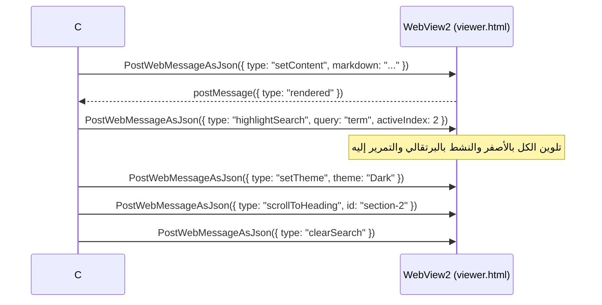

# دليل معمارية وهندسة الكود البرمجي (MDReader Codebase Architecture & Commercial Guide)

> **المشروع:** JMDReader (تطبيق قراءة وتحرير الماركداون والبيانات لنظام ويندوز)  
> **الناشر والمطور:** `birotech` (Abdullah Ali)  
> **الغرض:** توفير مرجع هندسي وتجاري شامل يوضح بنية الكود، وفصل الطبقات، ووظيفة كل زر وأداة، لتسهيل الصيانة، التطوير، أو البيع كمنتج رقمي متكامل لأي مبرمج أو جهة خارجية.

---

## 1. الهيكلية العامة وفصل المسؤوليات (Clean Architecture)

ينقسم المشروع إلى 3 مشاريع رئيسية تعتمد مبدأ **الفصل الصارم للمسؤوليات (Strict Separation of Concerns)**:

```
MDReader/
├── src/MDReader.Core/         — محرك النواة (منطق الأعمال، الماركداون، الجلسات، التصدير)
├── src/MDReader.App/          — واجهة المستخدم WinUI 3 ومحرك العرض WebView2
├── tests/MDReader.Core.Tests/ — اختبارات الوحدة، والضغط، ومقاومة الانهيارات (107 اختبارات)
└── docs/                      — التوثيق الهندسي والسياسات الرسمية
```

### 1.1 مشروع النواة `MDReader.Core` (منصة محايدة - Platform Neutral)
- **القاعدة الذهبية:** لا يحتوي مطلقاً على أي مرجع لمكتبات واجهة المستخدم (WinUI / Windows App SDK).
- **المحتويات:**
  - `Documents/DocumentSession.cs`: إدارة جلسة المستند، حالة التعديل (`IsDirty`)، والحفظ المتسلسل.
  - `Documents/DocumentTab.cs`: نموذج بيانات التبويب وحالة المستند المفتوح.
  - `Markdown/MarkdownDocument.cs`: معالجة نصوص الماركداون والتحقق من الأحجام الكبيرة.
  - `Markdown/MarkdownOutlineExtractor.cs`: استخراج فهرس العناوين (H1-H6) فائق السرعة عبر Regex.
  - `Markdown/MarkdownEditorUtilities.cs`: دوال البحث والاستبدال المتقدم (Regex/Literal)، واستيراد الصور.
  - `Export/HtmlDocumentExporter.cs`: تصدير صفحات HTML المستقلة مع تضمين الأنماط والخطوط.

---

## 2. جدول ودليل أزرار واجهة المستخدم (UI Controls & Button Dictionary)

يوضح هذا الجدول كل عنصر تفاعلي في واجهة التطبيق الرئيسية (`MainPage.xaml` و `MainWindow.xaml`):

### 2.1 شريط أدوات القراءة والتحرير العلوي (Capsule Toolbar)

| الأيقونة | معرف العنصر (x:Name) | الأمر / الدالة البرمجية | الوظيفة التقنية |
|:---:|---|---|---|
| **◫** | Split View Button | `SwitchViewModeCommand("Split")` | تقسيم الشاشة: محرر النصوص على اليسار والمعاينة الحية على اليمين. |
| **✏️** | Editor Only Button | `SwitchViewModeCommand("Editor")` | إخفاء المعاينة وعرض محرر الماركداون فقط للكتابة المركزة. |
| **📖** | Reading Mode Button | `SwitchViewModeCommand("Preview")` | وضع القراءة النقي: إخفاء المحرر وعرض المستند النهائي المنسق. |
| **B** | Bold Button | `InsertMarkdownSyntaxCommand("bold")` | إدراج تنسيق خط عريض `**نص**` عند المؤشر أو حول النص المحدد. |
| **I** | Italic Button | `InsertMarkdownSyntaxCommand("italic")` | إدراج تنسيق مائل `*نص*` عند المؤشر أو حول النص المحدد. |
| **H** | Heading Button | `InsertMarkdownSyntaxCommand("heading")` | إدراج ترويسة عنوان `# عنوان`. |
| **`<>`** | Code Button | `InsertMarkdownSyntaxCommand("code")` | إدراج صندوق كود برمجي ثلاثي ` ```lang `. |
| **📊** | Mermaid Button | `InsertMarkdownSyntaxCommand("mermaid")` | إدراج رسم تخطيطي انسيابي بصيغة Mermaid. |
| **💡** | Alert Button | `InsertMarkdownSyntaxCommand("alert")` | إدراج صندوق تنبيه ملون مثل `[!NOTE]` أو `[!TIP]`. |
| **∑** | Math Button | `InsertMarkdownSyntaxCommand("math")` | إدراج معادلة رياضية بتنسيق لاتيك `$$E=mc^2$$`. |
| **📑** | Outline Button | `ToggleOutlinePaneCommand` | فتح أو إغلاق درج فهرس العناوين الجانبي (Table of Contents). |
| **▶ / ⏸** | Auto-Scroll Button | `ToggleAutoScrollCommand` | تفعيل التمرير التلقائي السلس لقراءة الكتب والمستندات الطويلة دون لمس الفأرة. |
| **1x - 5x** | `ScrollSpeedCombo` | `ScrollSpeedCombo_SelectionChanged` | تحديد سرعة التمرير التلقائي (من 1x بطيء إلى 5x فائق أو سرعة مخصصة). |
| **🎨** | Theme Toggle Button | `CycleThemeCommand` | التبديل الدائري الفوري للثيم: فاتح (Light) ➔ داكن (Dark) ➔ سيبيا (Sepia). |
| **💬** | Comments Button | `ToggleCommentsPaneCommand` | إظهار أو إخفاء درج الملاحظات والتعليقات الجانبية على المستند. |
| **🖨️** | Export PDF Button | `ExportPdf_Click` | تصدير المستند فورياً كملف PDF عالي الدقة عبر `PrintToPdfAsync`. |
| **🌐** | Export HTML Button | `ExportHtml_Click` | تصدير المستند كملف HTML مستقل بالكامل يعمل بدون إنترنت. |
| **📋** | `CopyDocumentButton` | `CopyDocument_Click` | نسخ كامل نص المستند إلى حافظة ويندوز مع إشعار تأكيد بصري. |
| **📍** | Path Toggle Button | `TogglePathBarVisibilityCommand` | إظهار أو إخفاء شريط مسار الملف الحالي. |
| **⛶** | Focus Mode Button | `ToggleZenModeCommand` | تفعيل وضع التركيز التام (F11 Zen Mode) وإخفاء كافة القوائم. |
| **🔍-** | `ZoomOutButton` | `ZoomOut_Click` | تصغير حجم الخط والعرض بنسبة 10%. |
| **100%** | `ZoomResetButton` | `ZoomReset_Click` | إعادة ضبط العرض على الحجم الافتراضي (100%). |
| **🔍+** | `ZoomInButton` | `ZoomIn_Click` | تكبير حجم الخط والعرض بنسبة 10%. |

---

### 2.2 شريط البحث والاستبدال التفاعلي (Find & Replace Drawer)

| الرمز | معرّف العنصر | الحدث البرمجي | الوظيفة |
|:---:|---|---|---|
| **`🔍`** | `FindTextBox` | `TextChanged`, `KeyDown` | حقل كتابة كلمة البحث؛ يدعم التنقل بـ `Enter` و `Shift+Enter`. |
| **`Aa`** | `MatchCaseToggle` | `Click="FindOption_Changed"` | تفعيل/تعطيل حساسية الأحرف الكبيرة والصغيرة (Match Case). |
| **`.*`** | `RegexToggle` | `Click="FindOption_Changed"` | تفعيل محرك التعابير النمطية (Regular Expressions) المحمي بمهلة زمنية. |
| **`▲`** | Prev Match Button | `Click="FindPrevious_Click"` | الانتقال إلى المطابقة السابقة وتمرير الشاشة إليها وتلوينها بالبرتقالي. |
| **`▼`** | Next Match Button | `Click="FindNext_Click"` | الانتقال إلى المطابقة التالية وتمرير الشاشة إليها وتلوينها بالبرتقالي. |
| **`✕`** | Close Find Button | `Click="CloseFind_Click"` | إغلاق شريط البحث وإلغاء التمييز الأصفر فورياً (`Esc`). |
| **`🔄`** | `ReplaceTextBox` | `KeyDown` | حقل نص الاستبدال. |
| **`🔂`** | Replace Single Button | `Click="Replace_Click"` | استبدال النتيجة النشطة المحددة حالياً فقط. |
| **`🔁`** | Replace All Button | `Click="ReplaceAll_Click"` | استبدال كافة النتائج في المستند بنقرة واحدة مع عداد النتائج. |

---

## 3. بروتوكول المراسلة بين C# WinUI 3 ومحرك العرض WebView2 (IPC Protocol)

تتواصل واجهة C# مع كود العرض `viewer.html` عبر رسائل JSON غير متزامنة وآمنة تماماً:



---

## 4. إرشادات التطوير والتوسيع المستقبلي (Developer Onboarding)

1. **إضافة زر جديد في شريط الأدوات:**
   - أضف الزر داخل `MainPage.xaml` ضمن المجموعة المحددة (Pill Border).
   - اربطه بأمر في `ReaderViewModel.cs` باستخدام `[RelayCommand]`.
   - لا تضع منطق أعمال داخل `MainPage.xaml.cs`.
2. **إضافة ثيم جديد:**
   - عرّف ألوان الثيم في `src/MDReader.App/Shared/Styles/App.xaml` تحت `<ResourceDictionary x:Key="Default">`.
   - أضف متغيرات الألوان المقابلة في `src/MDReader.App/Assets/Renderer/viewer.html` تحت `body[data-theme="new_theme"]`.
3. **تشغيل الاختبارات:**
   - قبل أي Commit، شغّل دائماً:  
     `dotnet test tests/MDReader.Core.Tests -c Release`

---

## 5. ميثاق الحماية البرمجية الصارمة، Try-Catch، ومنع التهنيج (Zero-Crash & Anti-Hang Contract)

لضمان عمل التطبيق باستقرار 100% ومنع أي خروج مفاجئ أو تجميد للشاشة (Freezing)، يجب الالتزام الصارم بالمعايير التالية:

1. **معيار الحماية من الإغلاق الفجائي (Zero-Crash Mandate):**
   * يتم اعتراض كافة الاستثناءات غير المعالجة في `App.xaml.cs` عبر:
     - `UnhandledException += (s, e) => { e.Handled = true; ... };`
     - `TaskScheduler.UnobservedTaskException += (s, e) => { e.SetObserved(); ... };`
     - `AppDomain.CurrentDomain.UnhandledException += (s, e) => { ... };`
   * تسجيل تفاصيل أي خطأ في ملف تشخيصي محلي `crash.log` داخل `AppData/Local/MDReader` دون إغلاق التطبيق في وجه المستخدم.

2. **حظر استخدام `async void` غير المحمية (Strict Async Void Ban):**
   * يُمنع منعاً باتاً إنشاء أي دالة من نوع `async void` عدا أحداث الواجهة الرسومية (UI Events).
   * أي معالج حدث من نوع `async void` (مثل النقر أو السحب والإفلات أو أزرار التصدير) **يجب** أن يُحاط جسم الدالة بالكامل داخل `try { ... } catch (Exception ex) { ... }` لأن أي استثناء يفلت منها يُنهي عملية التطبيق بالكامل فوراً على ويندوز.

3. **منع التهنيج وتجمد الواجهة (Anti-Hang & UI Responsiveness):**
   * **تأخير الكتابة السريعة (Debouncing):** استخدام `DispatcherTimer` بفاصل 180ms لمنع إغراق محرك العرض بآلاف العمليات أثناء الطباعة السريعة في الملفات الضخمة.
   * **الحماية من هجمات ReDoS:** تزويد كافة التعبيرات النمطية (Regex) بمهلة زمنية صارمة `TimeSpan.FromSeconds(1)`.
   * **عدم حظر واجهة المستخدم:** إبقاء كافة عمليات القراءة والكتابة للملفات على مسارات غير متزامنة (`await ReadAllTextAsync`).

4. **أمان قراءة وحفظ الملفات (Non-Locking Atomic I/O):**
   * فتح الملفات بوضع مشاركة غير قافل `FileShare.ReadWrite` لتفادي تصادم البرنامج مع برامج المزامنة أو محررات الأكواد الخارجية.
   * حفظ الملفات عبر ملفات مؤقتة بديلة (`.tmp`) متبوعة بعملية استبدال ذرية (Atomic Replacement) لمنع تلف الملفات عند انقطاع الكهرباء.

5. **السحب والإفلات الخارجي (Tab Drag-Out):**
   * دعم سحب التاب خارج التطبيق عبر حدث `TabDragStarting` في `TabView`.
   * تزويد حزمة `DataPackage` بملف النظام الفعلي (`StorageItems`) والنص الخام (`SetText`) لتمكين إفلات الملفات مباشرة في المتصفحات ومواقع الويب (Gmail, GitHub, Discord) والمجلدات وبرامج المحادثة.

---

## 6. معايير الأيقونات والتلميحات وشريط الأدوات التكيفي (UI Iconography & Adaptive Toolbar Standards)

1. **الأيقونات الواضحة والمفهومة:** استخدام أيقونات Fluent القياسية المعترف بها دولياً لكل وظيفة (مثل `◫`, `✏️`, `📖`, `✨`, `⚡`, `📊`, `📋`).
2. **التلميحات الشاملة (Hover & Long-Press Tooltips):** إلزامية وضع `ToolTipService.ToolTip` ثنائي اللغة (عربي / إنجليزي) لكل زر أو أداة تفاعلية، مع توضيح اختصار لوحة المفاتيح. تعمل هذه التلميحات تلقائياً عند تحريك الماوس أو النقر المطول على الشاشات اللمسية.
3. **شريط الأدوات التكيفي (Adaptive Toolbar):**
   * **الأدوات العامة الثابتة:** التكبير والتصغير (Zoom)، تبديل الثيم، نسخ النص، وضع التركيز الشامل (Zen Mode)، وإظهار/إخفاء مسار الملف.
   * **أدوات الماركداون (تظهر عند فتح ملف .md):** أزرار الخط الغامق والمائل والعناوين والأكواد ومخططات Mermaid.
   * **أدوات الـ JSON (تظهر عند فتح ملف .json):** أزرار تجميل وتنسيق الكود (`✨ Beautify`)، ضغط الكود (`⚡ Minify`)، تحويل إلى جدول ماركداون (`📊 To Table`)، وتوسيع وطي الشجرة (`⊞ / ⊟`).

---

## 7. سياسة صياغة المهام والبرومبتات الصارمة (Dual-Line Policy & Security Prompt Mandate)

كل مهمة برمجية جديدة تُسجل في المشروع (سواء في `.project/TASKS.md` أو على منصة `Linear.app` أو في أي توجيه أو برومبت لأي وكيل ذكاء اصطناعي أو مبرمج بشري) **يجب** أن تتضمن إلزامياً سطرين رئيسيين في بدايتها:

1. **سطر سياسة التطوير (Development Policy Reference):**
   ```text
   POLICY_REF: docs/DEVELOPMENT_RULES.md (Architecture, MVVM, Clean UI, Intuitive Iconography §12, Microsoft Store Standards)
   ```
2. **سطر أمان وحماية الكود (Code Security & Resilience Reference):**
   ```text
   SECURITY_REF: docs/DEVELOPMENT_RULES.md §11 (Zero-Crash Mandate, Protected Async Void, Safe Try/Catch, Non-Locking I/O, ReDoS Timeout)
   ```

هذا الربط الصارم يضمن أن أي مبرمج أو وكيل برمجيات ينفذ المهمة يلتزم تلقائياً بعمارة MVVM النظيفة، ومفاهيم الحماية الشاملة، ومنع الانهيار والإغلاق المفاجئ وتجمد الواجهة نهائياً.
