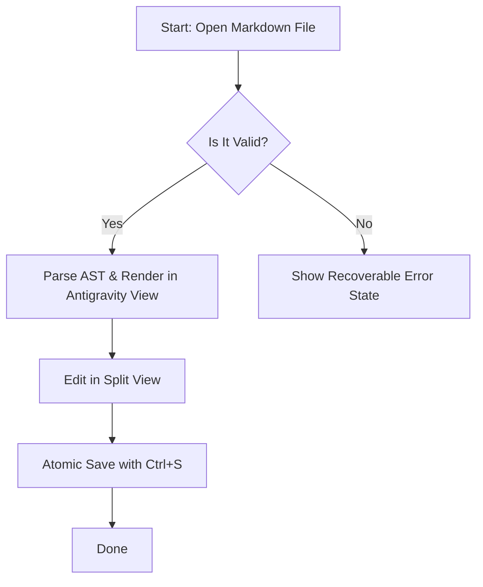

# مستند عرض ميزات Google Antigravity في MDReader

هذا المستند يوضح تكامل ميزات **Google Antigravity** في تطبيق **MDReader** الجديد بنظامه الهجين (WinUI 3 + Offline WebView2).

---

## 1. تنبيهات وبطاقات الماركداون (GitHub Alerts / Callouts)

> [!NOTE]
> هذا تنبيه للملاحظات الهامة باللون الأزرق كما يظهر تماماً في Antigravity.

> [!TIP]
> نصيحة ذكية للمطورين لتحسين الأداء وتسريع الكتابة.

> [!IMPORTANT]
> متطلب ضروري وحرج يجب الانتباه له بدقة.

> [!WARNING]
> تحذير هام من وقوع خطأ أو تغييرات قد تؤثر على النظام.

> [!CAUTION]
> إجراء عالي الخطورة يتطلب الحذر الشديد!

---

## 2. المخططات البيانية (Mermaid Diagrams)



---

## 3. المعادلات الرياضية (KaTeX Math Formulas)

معادلة آينشتاين الشهيرة للمادة والطاقة: $E = mc^2$ داخل النص.

والمعادلات الكبيرة ككتلة مستقلة:

$$ \int_{-\infty}^{\infty} e^{-x^2} dx = \sqrt{\pi} $$

$$ \frac{-b \pm \sqrt{b^2 - 4ac}}{2a} $$

---

## 4. كتل الأكواد البرمجية مع زر النسخ (Syntax & Copy Button)

```csharp
// مثال بلغة C# داخل MDReader
public sealed class MarkdownDocument
{
    public string Title { get; set; } = "Antigravity Reader";
    
    public void Save(string path)
    {
        MarkdownFileWriter.WriteFile(path, "# Content");
    }
}
```

```python
# مثال بايثون
def calculate_fibonacci(n):
    a, b = 0, 1
    for _ in range(n):
        yield a
        a, b = b, a + b
```

---

## 5. الجداول وقوائم المهام (GFM Tables & Task Lists)

| الميزة | الحالة في WinUI 3 | الدعم في Antigravity View |
| :--- | :--- | :--- |
| **التبويبات (Tabs)** | مدعومة بالكامل | نعم |
| **التنبيهات (Alerts)** | محلياً | نعم |
| **المحرر الحي (Split View)** | ثنائي الألواح | نعم |

### قائمة المهام:
- [x] إتاحة التحرير والحفظ الذري في Core
- [x] بناء نظام التبويبات المتعددة TabView
- [x] مستعرض شجرة المجلدات Workspace TreeView
- [x] بناء محرك العرض الهجين WebView2 أوفلاين
- [x] محرر النصوص وشريط التنسيق وأنماط العرض (Split / Edit / Read)
